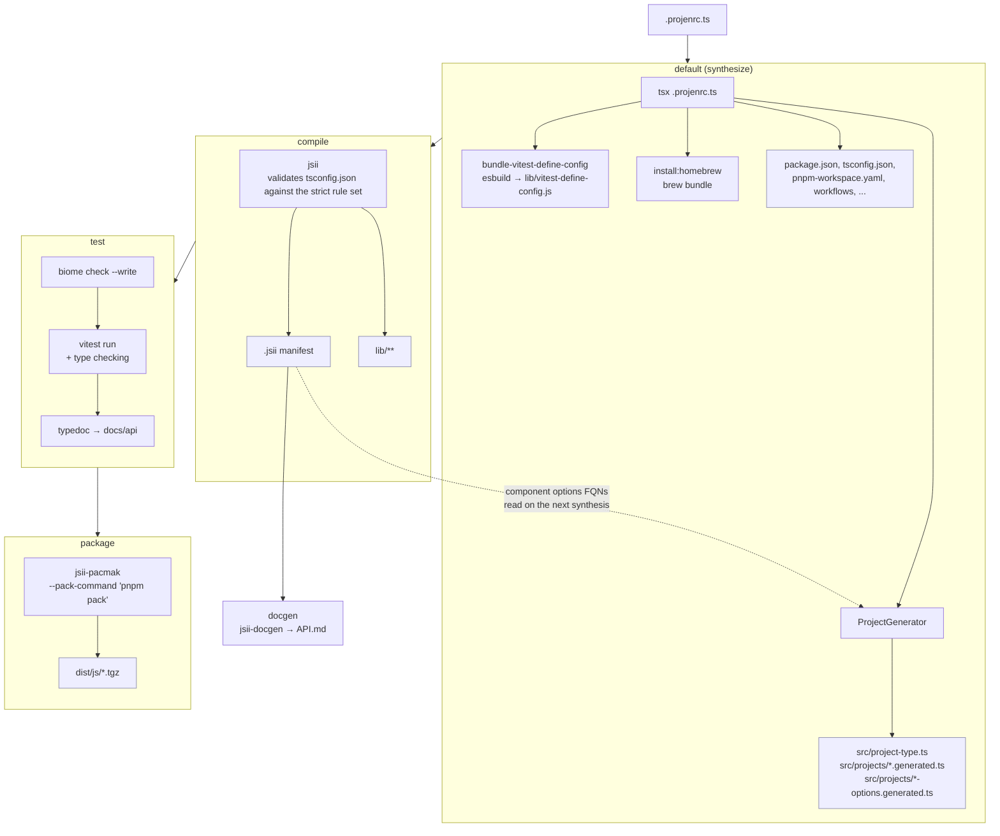

# @nikovirtala/projen-constructs

Projen project types with standard configuration for consistent project setup across all repositories.

## Installation

```bash
pnpm add -D @nikovirtala/projen-constructs projen constructs
```

Requires pnpm 12 and `projen` ^0.104.23. `@mrgrain/cdk-esbuild` and `constructs` are peer
dependencies as well.

To create a project from scratch:

```bash
pnpm dlx projen new --from @nikovirtala/projen-constructs aws_cdk_construct_library
```

## Features

- **Standard Configuration**: Opinionated defaults for author, release branch, package manager, Node.js, TypeScript, and tooling
- **Automatic Project Type Discovery**: Generates the `ProjectType` enum from Projen's JSII manifest (<!-- generated:project-type-count-start -->21<!-- generated:project-type-count-end --> project types)
- **Component System**: Reusable components (Vitest, TypeDoc, Mise, Homebrew, Colima, LocalStack, Lambda bundling)
- **Code Generation**: `ProjectGenerator` creates project classes with standard configuration
- **ES Modules**: TypeScript and CDK App projects use ES modules (JSII uses CommonJS)
- **Code Quality**: Biome for formatting and linting
- **Testing**: Vitest with coverage
- **Auto-merge**: Enabled with auto-approve
- **VSCode**: Recommended extensions and settings
- **mise**: Node version management

## Standard Configuration

<!-- generated:version-table-start -->
- **Author**: Niko Virtala (niko.virtala@hey.com)
- **Default release branch**: main
- **Package manager**: pnpm 12.16.1
- **Node version**: 26.13.0
- **TypeScript**: 6.0.3
- **CDK version**: 2.275.0 (for CDK projects)
- **JSII version**: ~6.0.3 (for JSII projects)
<!-- generated:version-table-end -->

The AWS CDK, Node.js and TypeScript versions live in `src/versions.json` and are refreshed by the
`update-versions` task, which the dependency upgrade workflow runs.

### pnpm

pnpm reads its settings from `pnpm-workspace.yaml`, not `.npmrc`, since pnpm 11. Generated projects
get:

| Setting                | Value             | Reason                                                                                                       |
| ---------------------- | ----------------- | ------------------------------------------------------------------------------------------------------------ |
| `nodeLinker`           | `hoisted`         | jsii tooling resolves dependencies from a flat `node_modules`                                                |
| `allowBuilds`          | `esbuild: true`   | esbuild links its platform binary in a postinstall script, and pnpm 11 fails an install with ignored builds   |
| `verifyDepsBeforeRun`  | `false`           | projen resolves the task `PATH` with `$(pnpm -c exec ...)`, which otherwise re-enters `pnpm install` and deadlocks |
| `minimumReleaseAge`    | `0`              | the pnpm 11 default of 1440 minutes makes pnpm write `minimumReleaseAgeExclude` entries into this generated file |

### TypeScript configuration

Projen renders three configs, and none of them should be edited directly:

- `tsconfig.json` compiles `src` to `lib`. For JSII projects, jsii validates it against its `strict`
  rule set, so it only carries compiler options jsii accepts.
- `test/tsconfig.json` extends it and is type-check only. This is the config Vitest type checking and
  the editor use, and the one `tsconfigDev` points at.
- `projenrc/tsconfig.json` covers `.projenrc.ts`.

### Native TypeScript

TypeScript and AWS CDK app projects run TypeScript with Node.js's built-in
[type stripping](https://nodejs.org/api/typescript.html#type-stripping) instead of `tsx` or
`ts-node`: the default task is `node .projenrc.ts`, and the cdk.json `app` is `node src/main.ts`.
Their `tsconfig.json` sets `erasableSyntaxOnly` and `verbatimModuleSyntax`, so `tsc` reports code
that Node.js can't run before Node.js does.

Code in these projects must therefore:

- only use syntax that can be stripped: no `enum`s (use an `as const` object), no namespaces with
  values, and no constructor parameter properties
- mark type-only imports with `type` (Biome's `useImportType` fixes these)
- import relative files with their `.ts` extension, and never import a directory
- use Node.js [subpath imports](https://nodejs.org/api/packages.html#subpath-imports)
  (`#stacks` in `package.json` `imports`) instead of tsconfig `paths`, which Node.js doesn't read
- import packages without an `exports` map either from the package root or with an explicit file,
  e.g. `projen/lib/component.js` rather than `projen/lib/component`

Lambda handlers bundled by esbuild and tests run by Vitest aren't run by Node.js directly, but the
same compiler options apply to them.

JSII and AWS CDK construct library projects keep using `tsx`, because jsii compiles to CommonJS, and
their `.projenrc.ts` often imports their own `src`.

When you start a new project by hand, make sure `package.json` has `"type": "module"` before the
first `node .projenrc.ts`: `npm init` writes `"type": "commonjs"`, which makes Node.js reject the
`import` statements in `.projenrc.ts`.

## Customization

Override any option by passing it to the constructor:

```typescript
import { JsiiProject } from "@nikovirtala/projen-constructs";

const project = new JsiiProject({
  name: "my-project",
  repositoryUrl: "https://github.com/nikovirtala/my-project.git",
  minNodeVersion: "26.0.0",
  author: "Custom Author",
  authorAddress: "custom@example.com",
  mise: false,
  vitest: false,
  tsconfig: {
    compilerOptions: {
      noUnusedLocals: false,
    },
  },
  biomeOptions: {
    biomeConfig: {
      formatter: {
        lineWidth: 100,
      },
    },
  },
});
```

Every component is exposed as an enable flag (`mise`, `vitest`, ...) plus an options property
(`miseOptions`, `vitestOptions`, ...).

## Usage

### Projects

#### AWS CDK Construct Library Project

```typescript
import { AwsCdkConstructLibraryProject } from "@nikovirtala/projen-constructs";

const project = new AwsCdkConstructLibraryProject({
  name: "my-cdk-construct",
  repositoryUrl: "https://github.com/nikovirtala/my-cdk-construct.git",
});

project.synth();
```

#### AWS CDK TypeScript App Project

```typescript
import { AwsCdkTypeScriptAppProject } from "@nikovirtala/projen-constructs";

const project = new AwsCdkTypeScriptAppProject({
  name: "my-cdk-app",
  repository: "https://github.com/nikovirtala/my-cdk-app.git",
});

project.synth();
```

#### JSII Project

```typescript
import { JsiiProject } from "@nikovirtala/projen-constructs";

const project = new JsiiProject({
  name: "my-jsii-project",
  repositoryUrl: "https://github.com/nikovirtala/my-jsii-project.git",
});

project.synth();
```

#### TypeScript Project

```typescript
import { TypeScriptProject } from "@nikovirtala/projen-constructs";

const project = new TypeScriptProject({
  name: "my-typescript-project",
  repository: "https://github.com/nikovirtala/my-typescript-project.git",
});

project.synth();
```

### Components

The package includes reusable components for common development tasks:

#### Vitest

[Vitest](https://vitest.dev) testing framework component.

```typescript
import { Vitest, CoverageProvider, CoverageReporter } from "@nikovirtala/projen-constructs";

new Vitest(project, {
  vitestVersion: "^5",
  config: {
    coverageProvider: CoverageProvider.V8,
    coverageReporters: [CoverageReporter.TEXT, CoverageReporter.LCOV],
  },
});
```

Type checking runs against the project's development tsconfig (`test/tsconfig.json`) unless
`config.typecheckTsconfig` says otherwise.

For Vitest settings that `config` doesn't cover, use `extraTestConfig` (merged into `test`) and
`extraConfig` (top-level options next to `test`):

```typescript
import { Vitest } from "@nikovirtala/projen-constructs";

new Vitest(project, {
  extraTestConfig: {
    setupFiles: ["test/setup.ts"],
  },
  extraConfig: {
    resolve: { alias: { "@": "/src" } },
  },
});
```

`extraTestConfig` is deep-merged over the generated `test` options: objects merge, and other values
(including arrays) replace the generated value. Both options are rendered as JSON, so their values
can't contain functions or regular expressions, which rules out plugins.

#### TypeDoc

[TypeDoc](https://typedoc.org) documentation generation component.

```typescript
import { TypeDoc, EntryPointStrategy } from "@nikovirtala/projen-constructs";

new TypeDoc(project, {
  version: "^0.28",
  typeDocConfig: {
    entryPointStrategy: EntryPointStrategy.EXPAND,
    out: "docs/api",
    exclude: ["**/*.test.ts"],
  },
});
```

#### Mise

[Mise](https://mise.jdx.dev) dev tools/runtimes management component.

```typescript
import { Mise } from "@nikovirtala/projen-constructs";

new Mise(project, {
  nodeVersion: "26.13.0",
});
```

#### Homebrew

[Homebrew](https://brew.sh) package management component. Writes a `Brewfile` and adds an
`install:homebrew` task that bootstraps Homebrew and runs `brew bundle`.

```typescript
import { Homebrew } from "@nikovirtala/projen-constructs";

const homebrew = new Homebrew(project, {
  packages: ["jq", "yq"],
});

homebrew.addPackage("gh");
```

A fully qualified formula (`user/repository/formula`) also adds a `tap` entry. Since Homebrew 6,
formulae from non-official taps only load when trusted, so they're written with `trusted: true`.
That trusts only the formula, not the rest of its tap.

#### Colima

[Colima](https://github.com/abiosoft/colima) container runtime component. Alternative for Docker.

```typescript
import { Colima } from "@nikovirtala/projen-constructs";

new Colima(project);
```

#### LocalStack

[LocalStack](https://www.localstack.cloud) AWS emulation component.

```typescript
import { LocalStack } from "@nikovirtala/projen-constructs";

new LocalStack(project, {
  services: ["s3", "lambda", "dynamodb"],
  port: 4566,
  debug: true,
});
```

#### LambdaFunctionConstructGenerator

Generates AWS CDK Lambda Function constructs and bundles their code.

```typescript
import { LambdaFunctionConstructGenerator } from "@nikovirtala/projen-constructs";

new LambdaFunctionConstructGenerator(project, {
  sourceDir: "src/handlers",
  outputDir: "src/constructs/lambda",
  filePattern: "*.lambda.ts",
  esbuildOptions: {
    minify: true,
    sourcemap: true,
  },
});
```

#### Bundler

Low-level bundling utilities for Lambda functions.

```typescript
import {
  Bundler,
  LambdaFunctionCodeBundle,
} from "@nikovirtala/projen-constructs";

const bundler = new Bundler(project, {
  assetsDir: "assets",
  esbuildVersion: "^0.25",
});

new LambdaFunctionCodeBundle(project, {
  entrypoint: "src/my-function.lambda.ts",
  extension: ".lambda.ts",
});
```

#### ProjectGenerator

Generates TypeScript project classes with standard configuration.

```typescript
import { ProjectGenerator, ProjectType, Mise, Vitest } from "@nikovirtala/projen-constructs";

new ProjectGenerator(project, {
  name: "TypeScriptProject",
  projectType: ProjectType.TYPE_SCRIPT_PROJECT,
  filePath: "./src/projects/typescript.generated.ts",
  components: [
    { componentClass: Mise },
    { componentClass: Vitest }, // Auto-detects VitestOptions from JSII manifest
  ],
});
```

Features:

- Automatically generates the `ProjectType` enum from Projen's JSII manifest
- Auto-detects component options types from JSII manifests
- Strips Projen's `@pjnew` annotation from `packageManager`, which `projen new` would otherwise
  render into a generated `.projenrc.ts` as the package manager that ran the command
- Validates paths to prevent directory traversal attacks
- Structured error handling with custom error classes

## Migrating from the standalone packages

The components used to be published as separate packages. Those packages are deprecated and won't
get new features or fixes. Every class, interface, enum and function they exported is exported from
`@nikovirtala/projen-constructs` under the same name, except `AwsCdkApp` (see below).

| Deprecated package | Replacement in `@nikovirtala/projen-constructs` |
| --- | --- |
| `@nikovirtala/projen-vitest` | `Vitest`, `VitestOptions`, `VitestConfigOptions`, `Environment`, `Pool`, `CoverageProvider`, `CoverageReporter` |
| `@nikovirtala/projen-typedoc` | `TypeDoc`, `TypeDocOptions`, `TypeDocConfiguration` and its enums |
| `@nikovirtala/projen-homebrew` | `Homebrew`, `HomebrewOptions` |
| `@nikovirtala/projen-colima` | `Colima` |
| `@nikovirtala/projen-localstack` | `LocalStack`, `LocalStackOptions` |
| `@nikovirtala/projen-bundle-lambda-function-code` | `Bundler`, `LambdaFunctionCodeBundle`, `LambdaFunctionCodeBundler` and their options |
| `@nikovirtala/projen-lambda-function-construct-generator` | `LambdaFunctionConstructGenerator`, `LambdaFunctionConstructGeneratorOptions` |
| `@nikovirtala/projen-aws-cdk-app` | `AwsCdkTypeScriptAppProject`, `AwsCdkTypeScriptAppProjectOptions` |

### Steps

1. In `.projenrc.ts`, replace the old package in `devDeps` with `@nikovirtala/projen-constructs`, and
   change the imports:

   ```typescript
   // before
   import { Vitest } from "@nikovirtala/projen-vitest";
   // after
   import { Vitest } from "@nikovirtala/projen-constructs";
   ```

2. Check the peer dependencies. `@nikovirtala/projen-constructs` needs `projen` ^0.104.23, `constructs`
   ^10 and `@mrgrain/cdk-esbuild` ^5. The standalone packages accepted older projen versions, so you
   may have to upgrade projen in the same change.
3. Install the new package, run `npx projen` and review the changes to the generated files.

### Changes to expect

These are the differences in behaviour or generated files between the standalone packages and this
library.

**Vitest**

- `vitest.config.ts` imports `defineConfig` from
  `@nikovirtala/projen-constructs/lib/vitest-define-config` instead of
  `@nikovirtala/projen-vitest/lib/bundled-define-config`. Projen rewrites the file, so there's
  nothing to change by hand.
- The config is rendered as JSON, so its keys are quoted. The settings are the same.
- `config.typecheckTsconfig` defaults to the project's development tsconfig (`test/tsconfig.json`
  in current projen) instead of `tsconfig.dev.json`.
- JSII and construct library projects exclude `vitest.config.ts` from the published package.
- New: `extraTestConfig` and `extraConfig` for Vitest settings that `config` doesn't cover.

**Homebrew and Colima**

- Packages from a tap (`owner/tap/formula`) also add a `tap` line to the `Brewfile`, and the
  `Brewfile` is sorted.
- The `install:homebrew`, `homebrew:bundle` and `colima` tasks run in bash. `homebrew:bundle` also
  finds a freshly installed `brew` that isn't on the `PATH` yet.

**LocalStack**

- `imageTag` is applied: LocalStack starts with `localstack/localstack:<imageTag>`. It used to be
  ignored.

**Bundler / LambdaFunctionCodeBundler**

- `LambdaFunctionCodeBundler.bundleOptions` applies to every discovered entrypoint. Its `entrypoint`
  used to replace them all.

**LambdaFunctionConstructGenerator**

- The bundle task runs `tsx` with the project's development tsconfig instead of `tsconfig.dev.json`.

**TypeDoc**: no changes.

### From `AwsCdkApp` to `AwsCdkTypeScriptAppProject`

```typescript
// before
import { AwsCdkApp } from "@nikovirtala/projen-aws-cdk-app";
const project = new AwsCdkApp({ name: "my-app", cdkVersion: "2.221.0" });

// after
import { AwsCdkTypeScriptAppProject } from "@nikovirtala/projen-constructs";
const project = new AwsCdkTypeScriptAppProject({ name: "my-app", cdkVersion: "2.221.0" });
```

Both are ES module apps using pnpm, Biome, Vitest and mise. The differences:

- **Native TypeScript**: `.projenrc.ts` and the app run with `node` instead of `tsx`, and the
  tsconfig sets `erasableSyntaxOnly` and `verbatimModuleSyntax` (see [Native TypeScript](#native-typescript)).

- **`nvm` is removed.** Use mise (on by default), which pins the Node.js version in `mise.toml`.
- **Homebrew is on by default.** The project gets a `Brewfile`, and `npx projen` runs
  `install:homebrew` (installs Homebrew if `brew` is missing) and `homebrew:bundle`. Set
  `homebrew: false` to turn it off.
- **cdk.json `app`** is `node src/main.ts` instead of `tsx --tsconfig tsconfig.json src/main.ts`.
- **Defaults** come from this library: Node.js, TypeScript, CDK and pnpm versions (pnpm 12 instead
  of 10), Dependabot off, auto-merge on, `auto-approve` and `auto-merge` labels on dependency
  upgrade PRs, and auto-approval of PRs by `nikovirtala`. Any option you set explicitly still wins,
  so set `autoApproveOptions` if you aren't `nikovirtala`.
- **tsconfig**: `noImplicitOverride` and `allowSyntheticDefaultImports` move from `tsconfig.json`
  to the development tsconfig (`test/tsconfig.json`).
- **Options removed from the interface**: `eslint`, `jest`, `prettier` (and their options),
  `sampleCode` and `tsJestOptions`.
- `vitestOptions` takes the `VitestOptions` of this library, and now also `homebrewOptions` and
  `miseOptions`.

## Development

This project is managed by Projen and generates itself: `.projenrc.ts` defines the project using the
`JsiiProject` type from `src/`. Configuration changes belong in `.projenrc.ts`, never in the
generated files.

```bash
pnpm projen           # synthesize project files
pnpm build            # synthesize, compile, test and package
pnpm test             # biome, vitest, typedoc
pnpm test:watch       # vitest in watch mode
pnpm test:update      # update snapshots
pnpm biome            # format and lint
pnpm docgen           # regenerate API.md from the .jsii manifest
pnpm update-versions  # refresh src/versions.json
pnpm upgrade          # upgrade dependencies
```

### Build process



The dashed edge is the part worth knowing about: `ProjectGenerator` reads the committed `.jsii`
manifest to resolve component options types, so the manifest produced by `compile` feeds the *next*
synthesis. This is why `.jsii` is committed rather than ignored. A component options type that is
missing from the manifest is reported as a warning and its options property is left out of the
generated interface, which is expected only while a new component is being introduced: compile once,
then synthesize again.

`package` runs `package:js` on CI and `package-all` locally; both end up in `jsii-pacmak`.
`docgen` is not part of `build` and has to be run explicitly after the manifest changes.
