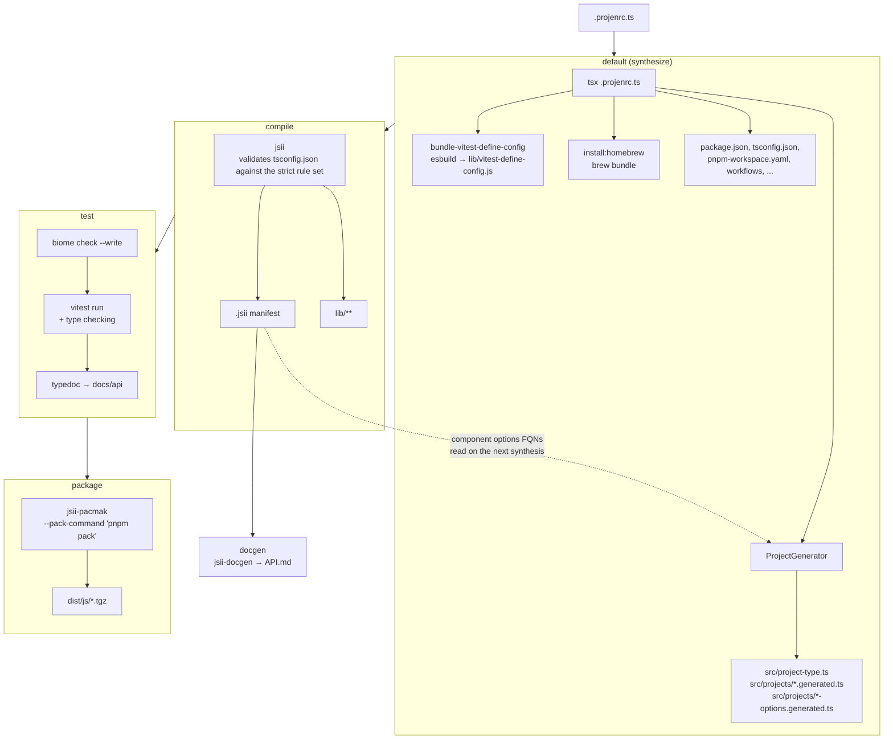

# Development

This project is managed by projen and generates itself: `.projenrc.ts` defines the project using the
`JsiiProject` type from `src/`. Configuration changes belong in `.projenrc.ts`, never in the
generated files.

## Commands

```bash
pnpm projen           # synthesize project files
pnpm build            # synthesize, compile, test and package
pnpm test             # biome, vitest, typedoc
pnpm test:watch       # vitest in watch mode
pnpm test:update      # update snapshots
pnpm biome            # format and lint
pnpm docgen           # regenerate API.md from the .jsii manifest
pnpm update-versions  # refresh src/versions.json
pnpm upgrade          # upgrade dependencies
```

## Build process

The diagram below shows how synthesis, compile, test and package connect. Each node names a task or
artifact, and the arrows show the order they run in.



The dashed edge is the part worth knowing about: `ProjectGenerator` reads the committed `.jsii`
manifest to resolve component options types, so the manifest produced by `compile` feeds the *next*
synthesis. This is why `.jsii` is committed rather than ignored. A component options type that is
missing from the manifest is reported as a warning and its options property is left out of the
generated interface, which is expected only while a new component is being introduced: compile once,
then synthesize again.

`package` runs `package:js` on CI and `package-all` locally; both end up in `jsii-pacmak`.
`docgen` is not part of `build` and has to be run explicitly after the manifest changes.
